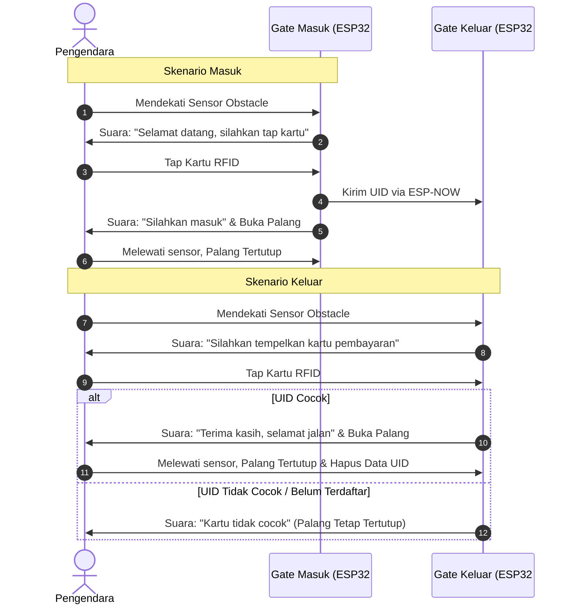

# 🚗 Sistem Parkir Otomatis Berbasis ESP32 (ESP-NOW)

Projek sistem palang pintu parkir pintar sederhana menggunakan mikrokontroler **ESP32**, **RFID RC522**, **Servo SG90**, dan modul audio **DFPlayer Mini**. Sistem ini terdiri dari **Gate Masuk** dan **Gate Keluar** yang berkomunikasi secara nirkabel menggunakan protokol **ESP-NOW** tanpa memerlukan jaringan internet/WiFi router.

---

## 🛠️ Fitur Utama

1. **Deteksi Kendaraan Otomatis**: Sensor obstacle/proximity mendeteksi kedatangan kendaraan dan memicu output suara.
2. **Panduan Suara (Voice Guidance)**: Menggunakan modul DFPlayer Mini untuk memberikan instruksi suara interaktif pada setiap tahap transaksi parkir.
3. **Penyimpanan & Komunikasi UID Nirkabel**: Data UID kartu RFID yang di-tap di Gate Masuk dikirimkan langsung ke Gate Keluar melalui protokol **ESP-NOW**.
4. **Validasi Kartu di Gate Keluar**: Gate Keluar hanya akan membuka palang jika UID kartu yang di-tap cocok dengan data UID terdaftar dari Gate Masuk.

---

## 🧰 Komponen Hardware

| Komponen | Jumlah | Keterangan |
| :--- | :---: | :--- |
| **ESP32 Development Board** | 2 Pcs | 1x Gate Masuk, 1x Gate Keluar |
| **RFID Reader RC522** | 2 Pcs | Pembaca kartu RFID (SPI) |
| **Servo SG90** | 2 Pcs | Penggerak palang pintu parkir |
| **Sensor Obstacle / Proximity (IR)** | 2 Pcs | Pendeteksi ada/tidaknya kendaraan |
| **DFPlayer Mini + Speaker** | 2 Set | Pemutar instruksi suara `.mp3` |
| **Kartu / Keyfob RFID (13.56 MHz)** | Secukupnya | Kartu akses parkir |
| **Power Supply / Adaptor 5V** | 2 Pcs | Catu daya untuk ESP32 & Servo |

---

## 🔌 Pin Mapping (Skema Rangkaian)

> *Konfigurasi pin ini berlaku sama untuk ESP32 di **Gate Masuk** maupun **Gate Keluar**.*

| Komponen | Pin Komponen | Pin ESP32 |
| :--- | :--- | :--- |
| **RFID RC522** | SDA (SS) | GPIO 5 |
| | SCK | GPIO 18 |
| | MOSI | GPIO 23 |
| | MISO | GPIO 19 |
| | RST | GPIO 22 |
| | GND / 3.3V | GND / 3.3V *(Jangan hubungkan ke 5V!)* |
| **Servo SG90** | Signal (Kuning/Orange) | GPIO 4 |
| | VCC / GND | 5V / GND |
| **Sensor Obstacle** | OUT (Digital) | GPIO 13 |
| | VCC / GND | 3.3V / GND |
| **DFPlayer Mini** | TX | GPIO 16 (RX2) |
| | RX | GPIO 17 (TX2) *(Gunakan resistor 1kΩ bila perlu)* |
| | VCC / GND | 5V / GND |

---

## 📁 Struktur File Audio (MicroSD DFPlayer)

Format kartu MicroSD sebagai **FAT32**. Buat folder bernama `01` dan isikan file audio berikut:

```text
SD Card/
└── 01/
    ├── 001.mp3  <-- "Selamat datang, silahkan tap kartu"
    ├── 002.mp3  <-- "Silahkan masuk"
    ├── 003.mp3  <-- "Silahkan tempelkan kartu pembayaran"
    ├── 004.mp3  <-- "Kartu tidak cocok"
    └── 005.mp3  <-- "Terima kasih, selamat jalan"
```

---

## 🔄 Alur Kerja Sistem (Workflow)



---

## 💻 Program / Source Code

### 1. Cara Mencari MAC Address ESP32
Gunakan skrip di bawah ini pada ESP32 **Gate Keluar** untuk mendapatkan MAC Address yang akan dimasukkan ke program Gate Masuk:

```cpp
#include "WiFi.h"

void setup() {
  Serial.begin(115200);
  WiFi.mode(WIFI_MODE_STA);
  Serial.print("MAC Address ESP32 ini: ");
  Serial.println(WiFi.macAddress());
}

void loop() {}
```

---

### 2. Kode Gate Masuk (`esp-enterance.cpp`)

### 3. Kode Gate Keluar (`esp-gateexit.cpp`)


## 📚 Library yang Dibutuhkan (Arduino IDE)

Sebelum melakukan *compile*, pastikan library berikut telah terinstall melalui **Library Manager** di Arduino IDE:
* `MFRC522` by GitHubCommunity
* `ESP32Servo` by Kevin Harrington
* `DFRobotDFPlayerMini` by DFRobot

---

## 📝 Lisensi
Projek ini dibuat untuk keperluan edukasi dan pembelajaran praktikum siswa SMK Jurusan TAV / TEI / RPL / TKJ. Bebas untuk dikembangkan lebih lanjut!
